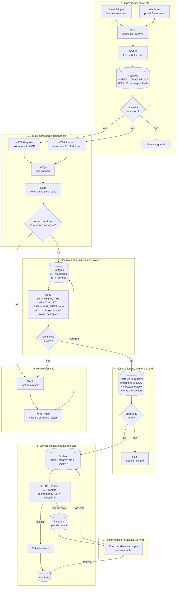
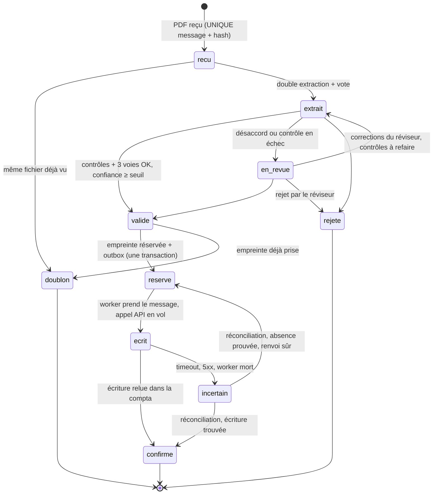

# Factures fournisseurs → comptabilité : rapprochement 3 voies, écriture « exactement une fois »

> **Exemple de portfolio.** Automatisation n8n conçue pour montrer comment on industrialise un flux
> comptable sans erreur silencieuse. Toutes les données du dépôt (fournisseurs, SIRET, IBAN, montants)
> sont **fictives**. Aucun paiement n'est jamais déclenché : le flux passe des écritures, il ne vire pas d'argent.

## Le problème

Une entreprise reçoit des factures fournisseurs en PDF, par email ou par un portail : des scans, des
documents de plusieurs pages, des avoirs, des acomptes. Il faut :

1. extraire les données de chaque facture ;
2. la rapprocher du **bon de commande** (ce qu'on a commandé) et du **bon de réception** (ce qu'on a reçu) :
   c'est le rapprochement en trois points ;
3. passer l'écriture comptable **une seule fois**, même si tout plante au mauvais moment.

## Pourquoi la plupart des automatisations échouent

| Ce qu'on voit dans les démos | Ce qui se passe en production |
|---|---|
| « Le LLM extrait la facture en JSON. » | Le JSON est **valide**, mais un montant est faux. Personne ne s'en aperçoit. |
| « On dédoublonne avec le hash du PDF. » | Le fournisseur ré-exporte le même PDF : autre hash, même facture, **payée deux fois**. |
| « n8n relance en cas d'erreur. » | L'écriture a réussi, le nœud suivant a planté. La relance crée une **deuxième écriture**. |
| « HT + TVA = TTC, c'est contrôlé. » | Un avoir (montants négatifs) ou une facture de solde (acompte déduit) casse les contrôles naïfs. |
| « 99 % de précision ! » | Mesuré sur quoi ? Sans jeu d'évaluation publié, c'est une impression. |

**n8n n'offre aucune garantie « exactement une fois » native.** Ses relances, ses webhooks et ses
exécutions concurrentes produisent naturellement des doublons. Cette garantie ne peut venir que de la
base de données : une **clé d'idempotence réservée avant tout effet de bord**, une **outbox** et une
**boucle de réconciliation** qui relit la comptabilité. C'est tout le sujet de ce dépôt.

**La promesse :** zéro erreur *silencieuse*. Pas 100 % d'automatisation. Tout ce qui est incertain part
en revue humaine, et chaque état incertain finit par être tranché par une preuve lue dans la compta.

## Vue d'ensemble



## La machine à états

Chaque facture a un état unique, stocké dans Postgres. Les transitions autorisées sont dans une table,
et un trigger refuse toutes les autres. Il est impossible, même par erreur dans le workflow, de passer
de `recu` à `confirme` ou d'être `confirme` sans référence d'écriture.



## Explication pas à pas

### 1. Ingestion idempotente
Le **Gmail Trigger** ou le **Webhook** du portail reçoit le PDF. Le nœud **Code** « Normaliser l'entrée »
exige un identifiant de message stable (id Gmail ou en-tête `Idempotency-Key` du portail) : sans lui,
aucune idempotence n'est possible, donc le message est refusé. Le nœud **Crypto** calcule le SHA-256 du PDF.
Le nœud **Postgres** fait `INSERT ... ON CONFLICT (source_message_id, file_sha256) DO NOTHING RETURNING id`.
Une relance du webhook ne retourne aucune ligne et s'arrête là.

### 2. Double extraction indépendante et vote
Deux extracteurs **de nature différente** lisent le même PDF : un OCR spécialisé factures (extracteur A)
et un LLM vision avec un schéma JSON strict à température 0 (extracteur B). Le nœud **Code** « Vote champ
par champ » normalise les deux sorties (dates, IBAN, numéros, montants en centimes) et ne retient une valeur
**que si les deux concordent**. Le moindre désaccord sur un champ critique envoie la facture en revue, avec
la liste des champs en cause.

Pourquoi deux extracteurs différents ? Parce que deux appels au même modèle font souvent la même erreur.
Et même deux extracteurs différents peuvent se tromper pareil : c'est le cas F12 du jeu d'évaluation.
C'est pour ça que l'étape 3 existe.

### 3. Contrôles déterministes et rapprochement 3 voies
Aucun LLM ici, que de l'arithmétique et des règles :

- **Somme des lignes = total HT**, au centime, en entiers. Pas de flottants.
- **TVA recalculée par taux = TVA imprimée** (tolérance d'un centime par taux, pour les arrondis).
- **HT + TVA = TTC**.
- **IBAN** : clé ISO 13616 (mod 97 = 1), et **IBAN identique à un IBAN connu du fournisseur**. Un IBAN
  nouveau, même valide, part toujours en revue : c'est le schéma de fraude le plus courant.
- **SIRET** : 14 chiffres avec clé de Luhn (avec l'exception connue de La Poste).
- **Rapprochement 3 voies** : le BC existe et appartient au fournisseur ; prix unitaire à ± 1 % du BC ;
  taux de TVA identique ; quantité déjà facturée + quantité facturée ≤ quantité reçue.
- **Avoirs** : montants négatifs exigés ; facture d'origine déjà engagée ; avoir ≤ facture d'origine ;
  pas de contrôle de réception.
- **Acomptes** : pas de bon de réception attendu, plafond de 40 % du HT commandé.
- **Factures de solde** : la ligne « acompte déduit » doit égaler les acomptes déjà engagés sur ce BC.

Le **score de confiance** est volontairement simple et explicable : 0 si un contrôle échoue, sinon
1 moins des pénalités fixes (écart de prix toléré, avoir, acompte, solde). Sous 0,90, la facture part en revue.

### 4. Réservation de l'empreinte, avant tout effet de bord
`ap.fn_reserve()` calcule une **empreinte normalisée** : SIREN, type de document, numéro normalisé
(`FA-2026/0042` = `fa 2026 42`), TTC en centimes et date. Puis, **dans une seule transaction** :

```sql
INSERT INTO ap.idempotency_keys (fingerprint, invoice_id, canonical)
VALUES (...) ON CONFLICT (fingerprint) DO NOTHING RETURNING invoice_id;
-- rien retourné => doublon : on s'arrête, aucune écriture possible
-- sinon        => état 'reserve' + message outbox, dans la même transaction
```

Le PDF ré-exporté par le fournisseur a un autre hash, mais la **même empreinte** : il est bloqué ici.
Un avoir qui porte le même numéro que sa facture a un autre type et un montant négatif : il n'est pas
pris pour un doublon.

### 5. Revue humaine
Le **Slack** prévient, le **Form Trigger** recueille la décision. Le réviseur peut valider, corriger un champ
ou rejeter. Une correction **ne force jamais** les contrôles : la facture corrigée repasse par l'étape 3.
Un humain ne peut donc pas faire passer « HT + TVA ≠ TTC ». Il corrige la donnée lue, ou il rejette et
demande une facture rectifiée. Chaque décision est tracée dans `audit`, qui est en ajout seul.

### 6. Worker outbox
Aucun nœud d'ingestion n'appelle la compta. Un **Schedule Trigger** lance chaque minute un worker qui prend
un lot avec `FOR UPDATE SKIP LOCKED`, ce qui empêche deux exécutions concurrentes de prendre le même message.
La facture passe à `ecrit` (appel en vol), puis le **HTTP Request** appelle l'API compta avec
`Idempotency-Key` = empreinte et `external_reference` = empreinte.

- Succès : on **relit** l'écriture (preuve), puis `confirme`.
- Timeout, 5xx ou réponse illisible : `incertain`. **On ne renvoie pas.** Renvoyer à l'aveugle, c'est
  exactement comme ça qu'on crée une double écriture.

### 7. Réconciliation
Toutes les 15 minutes, un autre **Schedule Trigger** liste les factures `incertain`, ainsi que celles
restées `ecrit` après expiration du bail (worker tué en plein appel). Il cherche dans la compta une
écriture portant l'empreinte :

- **trouvée** : `confirme`, sans renvoi ;
- **absente** : retour à `reserve`, l'outbox est remise en file avec un délai croissant. Après 5 tentatives,
  elle passe en `dead` et la supervision alerte ;
- **plusieurs** : erreur et alerte humaine (ne devrait jamais arriver).

La vue `ap.v_stuck` remonte toute facture bloquée dans un état non terminal depuis plus de 30 minutes.
C'est ce qui rend la promesse vérifiable : rien ne reste dans un état incertain sans que quelqu'un le sache.

## Les nœuds n8n utilisés

| Étape | Nœud n8n (type) |
|---|---|
| Réception | **Gmail Trigger** (`n8n-nodes-base.gmailTrigger`), **Webhook** (`n8n-nodes-base.webhook`) |
| Normalisation, vote, contrôles, verdict | **Code** (`n8n-nodes-base.code`) |
| Hash du PDF | **Crypto** (`n8n-nodes-base.crypto`) |
| État, idempotence, outbox | **Postgres** (`n8n-nodes-base.postgres`), opération *Execute Query* |
| Extracteurs, API compta | **HTTP Request** (`n8n-nodes-base.httpRequest`) |
| Jonction A + B | **Merge** (`n8n-nodes-base.merge`), *Combine by position* |
| Aiguillage | **If** (`n8n-nodes-base.if`), **Switch** (`n8n-nodes-base.switch`) |
| Revue | **Slack** (`n8n-nodes-base.slack`), **n8n Form Trigger** (`n8n-nodes-base.formTrigger`) |
| Worker, réconciliation | **Schedule Trigger** (`n8n-nodes-base.scheduleTrigger`) |
| Erreurs | **Error Trigger** (`n8n-nodes-base.errorTrigger`) |

Le fichier [`workflow/n8n-workflow.json`](workflow/n8n-workflow.json) s'importe dans n8n
(*Workflows → Import from File*). Tous les identifiants et toutes les URL sont **factices**
(`*.example.invalid`, `*_CRED_FACTICE_*`) : il faut brancher ses propres credentials et services.
L'Error Trigger n'est appelé que si le workflow est désigné comme *Error Workflow* dans ses paramètres
(ou déplacé dans un workflow d'erreur dédié).

## Garde-fous

- **Aucun paiement automatique.** Le flux s'arrête à l'écriture comptable.
- **Idempotence à deux niveaux** : `UNIQUE(source_message_id, file_sha256)` pour les relances techniques,
  empreinte métier UNIQUE pour les doublons réels.
- **Réservation avant effet de bord**, outbox dans la même transaction.
- **Jamais de renvoi aveugle** : tout échec ambigu devient `incertain` et seule une preuve lue dans la compta le tranche.
- **Transitions contrôlées par trigger**, `audit` et `state_transitions` en ajout seul.
- **IBAN nouveau ou modifié = revue**, toujours.
- **Un humain corrige ou rejette, il ne force pas** un contrôle arithmétique.
- **Montants en centimes entiers** dans le code et `numeric` dans Postgres. Jamais de flottants pour l'argent.
- **Évaluation reproductible** : [`eval/`](eval/) contient un jeu, une implémentation de référence et un script de métriques.

## Ce qu'on ne promet pas

- **Pas 100 % d'automatisation.** Une partie des factures part en revue, et c'est voulu.
  Sur le jeu synthétique, 2 factures correctes sont envoyées en revue « pour rien » (F11, F12) : c'est le prix
  de zéro erreur silencieuse.
- **Pas de précision chiffrée réelle.** Le jeu fourni est **synthétique** et construit pour illustrer les
  pièges. Il démontre la méthode de mesure, pas une performance. Pour annoncer un taux, il faut un jeu
  figé de 30 à 50 vraies factures anonymisées, avec leur vérité terrain.
- **Pas d'« exactement une fois » magique dans n8n.** C'est l'idempotence et la réconciliation côté base
  qui le fournissent. Si l'API compta ne permet ni clé d'idempotence ni recherche par référence externe,
  la réconciliation devient manuelle pour les cas incertains.
- **Pas d'agents qui s'améliorent seuls en production.** Les prompts et les seuils ne changent qu'après
  une mesure sur le jeu d'évaluation.
- **Pas de multi-agents décoratif.** Là où une vérification peut être déterministe (arithmétique, clés de
  contrôle, rapprochement), elle l'est.

## Contenu du dépôt

| Chemin | Rôle |
|---|---|
| [`MODES-DE-PANNE.md`](MODES-DE-PANNE.md) | Chaque panne, comment elle est détectée, comment elle est rattrapée |
| [`sql/schema.sql`](sql/schema.sql) | Schéma Postgres : tables, contraintes UNIQUE, machine à états, outbox, fonctions |
| [`sql/tests.sql`](sql/tests.sql) | Tests du schéma : doublons, transitions interdites, avoir, crash, réconciliation |
| [`workflow/n8n-workflow.json`](workflow/n8n-workflow.json) | Export n8n importable, identifiants factices |
| [`workflow/src/`](workflow/src/) | Code des nœuds Code, générateur du JSON, test des nœuds hors n8n |
| [`eval/`](eval/) | Jeu d'évaluation synthétique, pipeline de référence, calcul des métriques |

## Lancer les tests

```bash
# Schéma Postgres
createdb ap_demo && psql -d ap_demo -v ON_ERROR_STOP=1 -f sql/schema.sql -f sql/tests.sql

# Évaluation (Python 3.9+, aucune dépendance)
cd eval
python3 generer_jeu.py
python3 pipeline_reference.py --mode complet
python3 pipeline_reference.py --mode naif
python3 metriques.py sorties/sortie_complet.json --max-erreurs-silencieuses 0
python3 metriques.py sorties/sortie_naif.json

# Les nœuds Code du workflow décident-ils comme la référence ? (Node 18+)
cd .. && node workflow/src/test_code_nodes.js
```
